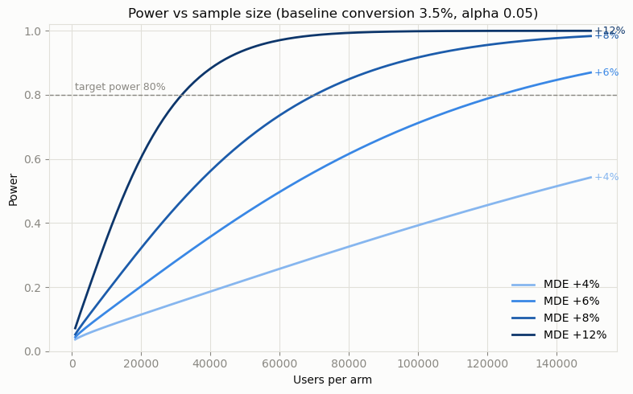
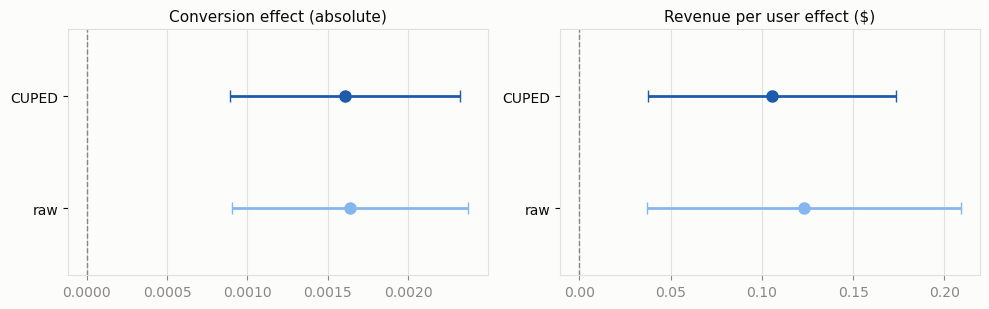
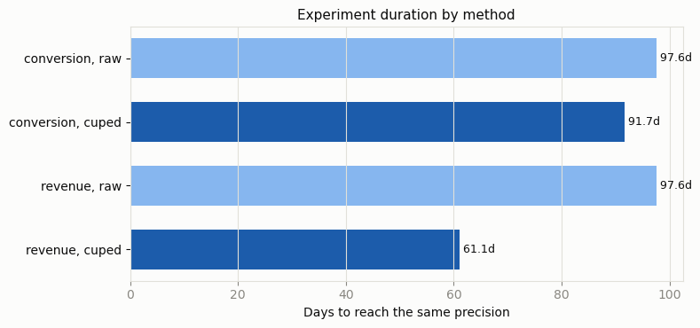

# Experimentation Decision Engine

A/B testing project that goes past "p < 0.05, ship it". It covers power analysis, CUPED variance reduction, and a ship/no-ship decision engine that treats guardrail metrics seriously. I built this as a data science portfolio project.

## Why I built it

Most A/B test writeups I found online stop at a t-test and a p-value. When I read about how real experimentation platforms work (Microsoft ExP, Spotify, Netflix), they do three harder things:

1. They design for power. Before running anything, they work out how many users a minimum detectable effect actually requires.
2. They squeeze more out of the same traffic. CUPED uses pre-experiment data to tighten confidence intervals, which means shorter experiments.
3. They decide under risk. A feature ships only if its success metrics improve AND its guardrail metrics are proven not to have degraded past a tolerance the business set in advance, with multiple-comparison control on the success family and explicit Type II risk on the guardrails.

This project implements all three, end to end, on a simulated e-commerce checkout experiment and then on a real 64,000-user email experiment to prove the machinery survives contact with real data.

## The scenario

An e-commerce platform tests a streamlined checkout flow (treatment) against the existing flow (control).

| role | metric | criterion |
|---|---|---|
| primary success | checkout conversion rate | significant improvement (one-sided, BH-corrected) |
| secondary success | revenue per user | significant improvement (one-sided, BH-corrected) |
| guardrail | average order value | must not drop more than 2% (non-inferiority) |
| guardrail | checkout error rate | must not rise more than 0.5pp (non-inferiority) |

The engine returns one of three verdicts. SHIP means the primary improved and every guardrail cleared with adequate power. DO NOT SHIP means the primary failed, or harm beyond a margin was established. INVESTIGATE means a guardrail came back inconclusive, which in practice usually means it was underpowered.

## Methodology and references

Power analysis uses the explicit two-proportion z-test formula from Fleiss, Levin & Paik (2003), cross-checked against statsmodels to within 1%. I wanted the formula written out by hand rather than hidden behind a library call.

CUPED follows Deng, Xu, Kohavi & Walker (2013, WSDM): theta = Cov(Y,X)/Var(X), pooled across arms.

Superiority and non-inferiority testing are both one-sided z-tests. Guardrails use shifted-hypothesis tests against the margin and report the CI relative to the margin along with the a priori power. The framing comes from Kohavi, Tang & Xu's "Trustworthy Online Controlled Experiments" and from Spotify engineering's guardrail decision framework, which is where I picked up the idea that guardrails should report Type II risk instead of receiving alpha correction.

Multiplicity is handled with Benjamini-Hochberg (1995), applied across the success-metric family only.

## Repository structure

```
config.py                    all parameters: ground truth, alpha, power, margins, traffic
data/generate_data.py        synthetic generator (two-latent user model, exact marginal rates)
src/power.py                 sample size and power, explicit formulas
src/cuped.py                 theta and the CUPED adjustment
src/tests_stats.py           superiority, non-inferiority, BH correction
src/decision_engine.py       MetricSpec, evaluate_experiment, DecisionReport
src/plots.py                 shared plotting utilities
notebooks/01..04             power design, CUPED, decision engine, real data
dashboard/app.py             Streamlit dashboard (dark theme, three tabs)
tests/test_stats.py          pytest unit tests for the statistical core
validate_phase1..3.py        simulation-based validation gates (see below)
reports/decision_memo.md     one-page stakeholder memo
```

## How to run everything

```bash
pip install -r requirements.txt

# validation gates (each prints PASS/FAIL per gate)
python validate_phase1.py     # power ~80%, A/A ~5%, formula vs statsmodels, correlations
python validate_phase2.py     # CUPED variance reduction = 1-rho^2, unbiasedness, A/A FPR
python validate_phase3.py     # NI test size and power, BH FDR control, scenario verdicts

# unit tests
python -m pytest tests/ -q

# notebooks (or open interactively)
jupyter nbconvert --to notebook --execute --inplace notebooks/01_power_analysis.ipynb

# dashboard
streamlit run dashboard/app.py
```

Notebook 04 downloads the Hillstrom CSV (about 5 MB) into `data/` on first run.

## Key results

Detecting a +8% relative lift on a 3.5% conversion baseline needs roughly 70k users per arm, which is 14 days at 10k users/day:



CUPED removes about 39% of revenue-per-user variance. That number is not a coincidence: it matches the theoretical rho squared exactly for the realized covariate correlation of 0.62. For the rare binary conversion metric the reduction is only about 6%, which lines up with what industry writeups report.





On the real Hillstrom experiment (Womens E-Mail vs No E-Mail), conversion and visits improve decisively and the all-user spend guardrail clears its margin, yet the engine still says INVESTIGATE, because the guardrail design only had about 13% power. Honest verdict, and exactly the behaviour I wanted. Real-data CUPED with a year-long history covariate gives a real but tiny 0.04% variance reduction (rho = 0.02). The method is identical to the synthetic case; the covariate quality is what decides the gain.


## Limitations and what I'd build next

CUPAC is the obvious upgrade. CUPED with a single covariate is the base case; predicting the outcome from all pre-experiment features would materially help the real-data case, where my one year-long covariate correlates at only 0.02 with two-week spend.

This project analyzes fixed-horizon experiments only. Production platforms add always-valid inference or group-sequential boundaries so experiments can be peeked at safely, and that would be the next statistical layer to add.

Everything here estimates average effects. Segment-level analysis (heterogeneous treatment effects) is the standard next question after a SHIP verdict, and I deliberately left it out of scope.

One finding I did not expect going in: guardrail power is expensive. Powering a 2% AOV margin needs roughly 13x the traffic of the primary conversion test. Real teams widen margins, switch to all-user formulations, or accept explicit Type II risk. The engine surfaces that trade-off instead of hiding it.

Finally, the synthetic generator uses homogeneous treatment effects and independent users. No network effects, novelty decay, or seasonality. An original dataset is hard to find which covers all these variables.
